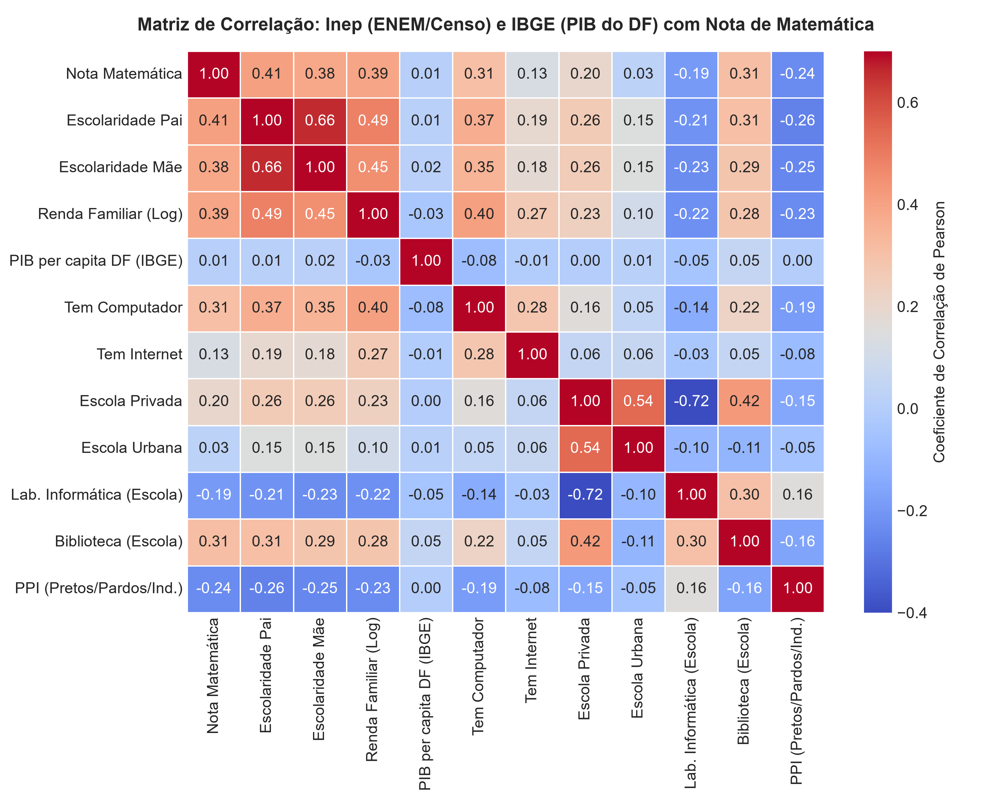
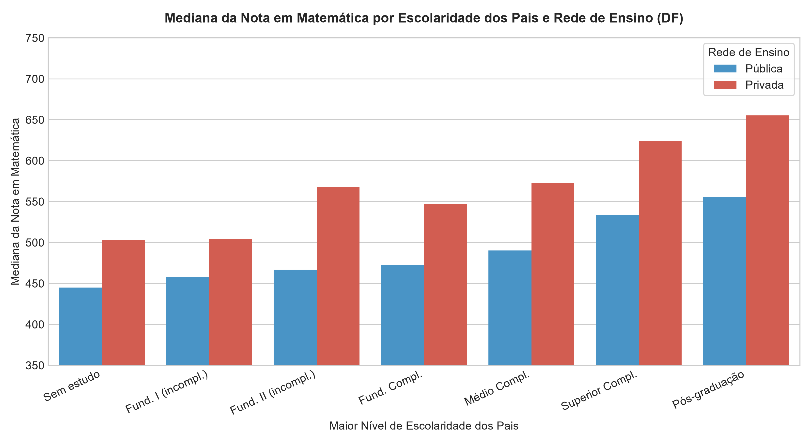
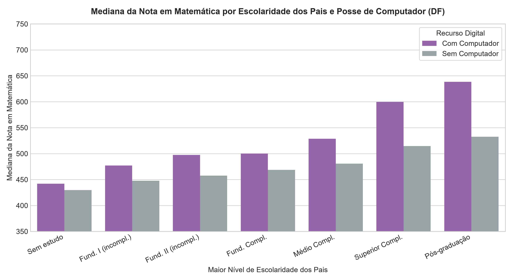
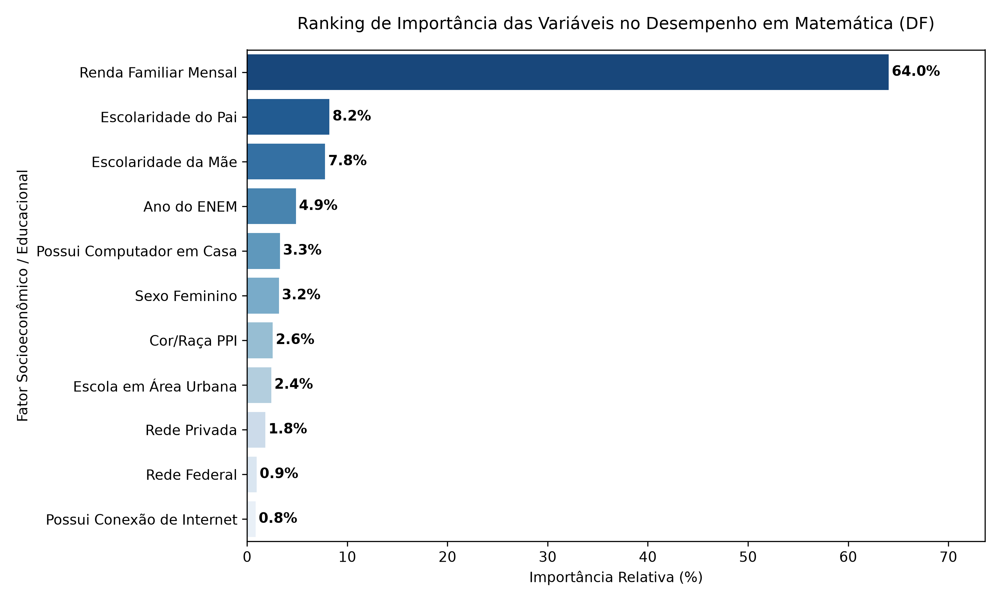

# 📊 Análise de Dados: Fatores Socioeconômicos, Escolares e o Desempenho no ENEM (DF: 2021–2023)

<div align="center">


**Universidade de Brasília – UnB**  
**Departamento de Ciência da Computação – CIC**  
*Tópicos Avançados em Computadores (TAC) / Mineração de Dados Educacionais*

</div>

---

### 👥 Equipe de Pesquisa:
- **Ana Caroline Freitas Brito** — Matrícula: `242001526`
- **Ana Sarah Nagata** — Matrícula: `242023176`
- **Kamily Silva Andrade Crispim** — Matrícula: `242009945`

---

## 🎯 Visão Geral do Projeto

Este projeto investiga de que maneira variáveis socioeconômicas (renda familiar, escolaridade dos pais), institucionais (dependência administrativa da escola pública vs. privada vs. federal) e infraestruturais (posse de computador, acesso à internet e laboratórios) se associam à proficiência em **Matemática e suas Tecnologias** no **ENEM no Distrito Federal** entre **2021 e 2023**.

A pesquisa dialoga diretamente com a literatura do Departamento de Ciência da Computação da UnB — em especial o estudo de **Silveira, Holanda e Ramos (2022)** —, recuando um estágio para examinar como as lacunas de preparo e os filtros que impactam a retenção inicial nos cursos de tecnologia (CS1) já se consolidam no ensino médio.

### 📑 Documentos e Entregáveis Prontos:
* 📄 **[Artigo Completo em PDF (Padrão SBC / IEEE)](Artigo_Completo_ENEM_DF_UnB.pdf)**: Artigo de 4 páginas formatado com figuras, tabelas e citações.
* 📝 **[Código-Fonte LaTeX do Artigo](artigo_enem_df.tex)**: Código completo pronto para compilar no Overleaf.
* 📊 **[Relatório Complementar de Figuras e Algoritmos](resultados/Relatorio_Figuras_e_Algoritmos_ENEM_DF.pdf)**.

---

## 📈 Showroom de Resultados

### 1. Matriz de Correlação de Pearson (Figura 1)
A nota de Matemática exibe forte associação com o capital econômico e cultural da família: correlação positiva com a **Renda Familiar ($r = 0{,}47$)**, **Escolaridade do Pai ($r = 0{,}38$)**, **Escolaridade da Mãe ($r = 0{,}36$)** e **Posse de Computador ($r = 0{,}33$)**, contrastando com correlação negativa com a condição PPI ($r = -0{,}26$).

<div align="center">
  
</div>

---

### 2. Disparidade por Rede de Ensino e Escolaridade dos Pais (Figura 2)
Embora a instrução familiar impulsione o desempenho em qualquer estrato, a **Rede Privada confere um prêmio acentuado** em todos os níveis: alunos da rede privada alcançam mediana de **$629{,}9$ pontos** contra **$501{,}3$ pontos** da rede pública distrital.

<div align="center">
  
</div>

---

### 3. O Impacto da Inclusão Digital (Figura 3)
A posse de computador doméstico revela um abismo educacional expressivo: participantes com computador obtêm mediana de **$575{,}5$ pontos**, contra apenas **$474{,}3$ pontos** dos que não dispõem da ferramenta — um diferencial direto de **$+101{,}2$ pontos**.

<div align="center">
  
</div>

---

### 4. Ranking de Importância via Random Forest Regressor (Figura 4)
No conjunto de teste ($30\%$, $N = 38.063$), o algoritmo atingiu $R^2 = 0{,}2896$ com MAE de $85{,}60$ pontos. O cálculo de pureza de nós (*Mean Decrease in Impurity*) comprova que **Renda Familiar ($64{,}05\%$)** e o **Capital Cultural dos Genitores ($16{,}01\%$)** concentram **mais de $80\%$ do poder preditivo** de toda a variância da nota.

<div align="center">
  
</div>

---

## 📋 Tabelas Científicas do Artigo

### Tabela 1. Coeficientes da Regressão Linear Múltipla OLS ($R^2 = 0{,}2784$, $N = 126.874$)
> *Modelo estimado por Mínimos Quadrados Ordinários ($F = 4.079, p < 0{,}001$).*

| Variável | Coeficiente ($\beta$) | Erro Padrão | Estatística $t$ | $p$-valor |
| :--- | :---: | :---: | :---: | :---: |
| **Intercepto ($\beta_0$)** | $373{,}13$ | $2{,}17$ | $171{,}6$ | $< 0{,}001$ |
| **Escolaridade Pai (anos)** | $+4{,}08$ | $0{,}09$ | $46{,}2$ | $< 0{,}001$ |
| **Escolaridade Mãe (anos)** | $+3{,}65$ | $0{,}09$ | $38{,}9$ | $< 0{,}001$ |
| **$\log(\text{Renda})$** | $+13{,}51$ | $0{,}22$ | $61{,}7$ | $< 0{,}001$ |
| **Possui Computador** | $+27{,}46$ | $0{,}84$ | $32{,}7$ | $< 0{,}001$ |
| **Escola Privada** | $+44{,}20$ | $1{,}15$ | $38{,}3$ | $< 0{,}001$ |
| **Escola Federal (IFB)** | $+45{,}39$ | $2{,}53$ | $17{,}9$ | $< 0{,}001$ |
| **Cor/Raça PPI** | $-24{,}19$ | $0{,}65$ | $-37{,}1$ | $< 0{,}001$ |
| **Sexo Feminino** | $-32{,}85$ | $0{,}64$ | $-51{,}5$ | $< 0{,}001$ |

---

### Tabela 2. Estatísticas Descritivas de Matemática por Subgrupo no DF ($N = 126.874$)

| Dimensão / Subcategoria | $N$ | Média | Mediana |
| :--- | :---: | :---: | :---: |
| **Dependência Administrativa** | | | |
| 🔹 Rede Privada | $18.377$ | $621{,}1$ | $629{,}9$ |
| 🔹 Rede Federal (IFB) | $2.207$ | $601{,}0$ | $600{,}5$ |
| 🔹 Rede Pública Distrital | $26.063$ | $511{,}6$ | $501{,}3$ |
| **Maior Escolaridade dos Pais** | | | |
| 🎓 Pós-graduação | $39.018$ | $623{,}7$ | $633{,}9$ |
| 🎓 Ensino Superior | $27.731$ | $586{,}2$ | $588{,}1$ |
| 🎓 Ensino Médio | $42.617$ | $521{,}1$ | $509{,}5$ |
| 🎓 Sem estudo | $1.574$ | $448{,}8$ | $435{,}5$ |
| **Recursos Tecnológicos** | | | |
| 💻 Possui Computador | $105.100$ | $578{,}0$ | $575{,}5$ |
| ❌ Não Possui Computador | $35.349$ | $487{,}5$ | $474{,}3$ |

---

## 💻 Como Reproduzir e Executar no seu Computador

O repositório já inclui a base tratada e integrada em [`data/processed/base_final_modelagem.csv`](data/processed/base_final_modelagem.csv) ($N = 126.874$), permitindo reproduzir todas as análises, gráficos e PDFs **sem precisar baixar os arquivos ZIP de gigabytes do Inep**.

### 1. Clonar o Repositório
```bash
git clone https://github.com/mrscaredycat/TAC---ANALISE-DE-DADOS-EDUCAIONAIS-.git
cd TAC---ANALISE-DE-DADOS-EDUCAIONAIS-
```

### 2. Instalar as Dependências
Recomenda-se criar um ambiente virtual (opcional, mas recomendado):
```bash
python -m venv venv
# No Windows:
.\venv\Scripts\activate
# No Linux/Mac:
source venv/bin/activate

pip install -r requirements.txt
```

### 3. Execução com Apenas 1 Comando (Automático)
Basta executar o script orquestrador:
```bash
python src/00_executar_pipeline.py
```
O script identificará automaticamente a base processada e executará:
1. Geração de todos os gráficos exploratórios (Heatmap, Barras, Evolução temporal);
2. Ajuste do modelo OLS e cálculo da Tabela 1;
3. Treinamento do Random Forest ($100$ árvores) e geração da Figura 4 e Tabela 2;
4. Compilação do artigo científico completo em PDF (`Artigo_Completo_ENEM_DF_UnB.pdf`).
*(Tempo total de execução estimado: ~50 segundos)*.

---

### 4. Execução Manual Passo a Passo (Opcional)
Se preferir rodar script por script individualmente:

```bash
# 1. Gráficos exploratórios e Heatmap
python src/06_analise_exploratoria.py

# 2. Regressão Linear Múltipla OLS
python src/07_regressao_linear.py

# 3. Random Forest Regressor e Feature Importance
python src/08_random_forest.py

# 4. Compilador do Artigo em PDF
python src/gerar_artigo_pdf.py
```

> **Nota:** Caso queira reprocessar os microdados brutos diretamente dos arquivos ZIP do Inep/IBGE do zero, basta colocar os ZIPs na raiz e executar `python src/00_executar_pipeline.py --full`.

---

## 🗂️ Estrutura do Repositório

```text
├── Artigo_Completo_ENEM_DF_UnB.pdf     <- Artigo final em PDF formatado (4 págs)
├── artigo_enem_df.tex                  <- Código-fonte completo em LaTeX para Overleaf
├── requirements.txt                    <- Dependências de execução (pandas, scikit, etc.)
├── README.md                           <- Este documento com visualizações completas
│
├── data/
│   └── processed/                      <- Dados consolidados e limpos do DF
│       ├── base_final_modelagem.csv    <- Base completa usada nos modelos (N=126.874)
│       ├── enem_df_2021_2023.csv       <- Painel consolidado do ENEM DF
│       └── censo_escolas_df_2021_2023.csv
│
├── resultados/
│   ├── figuras/                        <- Figuras em alta resolução (300 DPI)
│   │   ├── heatmap_correlacoes.png
│   │   ├── barras_mediana_escolaridade_rede.png
│   │   ├── barras_mediana_escolaridade_computador.png
│   │   ├── barras_mediana_escolaridade_localizacao.png
│   │   ├── evolucao_desempenho_anos.png
│   │   └── ranking_importancia_variaveis.png
│   │
│   └── tabelas/                        <- CSVs e resumos estatísticos gerados
│       ├── regressao_linear_coeficientes.csv
│       ├── regressao_linear_resumo.txt
│       ├── ranking_importancia_random_forest.csv
│       └── medias_notas_por_subcategoria.csv
│
└── src/
    ├── 00_executar_pipeline.py         <- Pipeline automático de execução rápida
    ├── 01_ambiente_e_verificacao.py    <- Diagnóstico de dependências
    ├── 02_inspecionar_colunas.py       <- Leitura de dicionários de dados
    ├── 03_filtrar_enem_df.py           <- Leitura em streaming dos zips do ENEM
    ├── 04_processar_censo_indicadores.py <- Processamento de dados escolares e INSE
    ├── 05_integrar_bases.py            <- Engenharia de atributos e merge
    ├── 06_analise_exploratoria.py      <- Criação dos gráficos e correlações
    ├── 07_regressao_linear.py          <- Modelagem econométrica OLS
    ├── 08_random_forest.py             <- Algoritmo de aprendizado de máquina
    └── gerar_artigo_pdf.py             <- Compilação do artigo em PDF com ReportLab
```

---

<div align="center">
  <b>Universidade de Brasília (UnB) — Departamento de Ciência da Computação (CIC)</b><br>
  <i>Brasília, Distrito Federal, Brasil</i>
</div>
